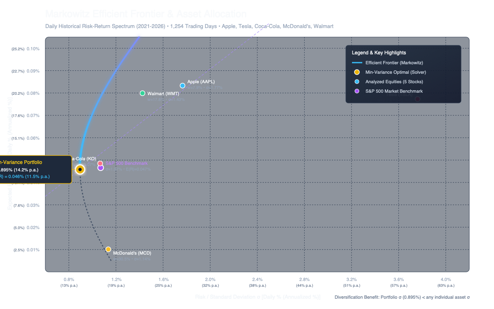
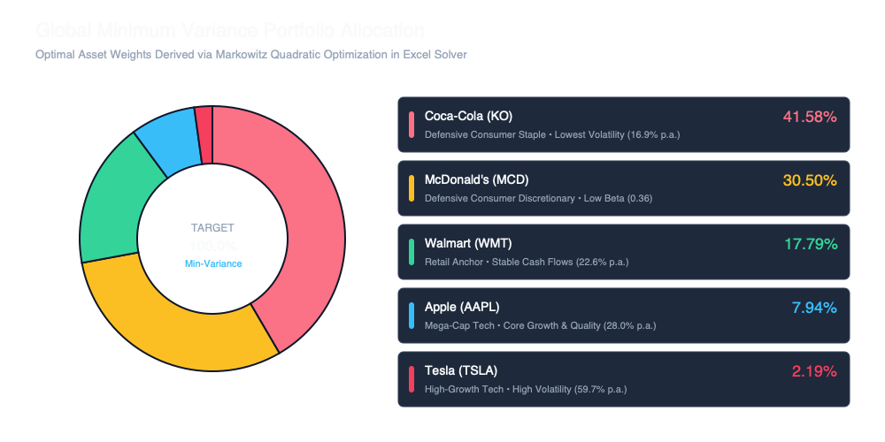

# Investment Portfolio Optimization & Efficient Frontier Analysis

[](https://github.com/Kaisix7/Investment-Portfolio/blob/main/Investment%20Portfolio.xlsx)
[-0284c7?style=flat)](https://en.wikipedia.org/wiki/Modern_portfolio_theory)
[](https://www.solver.com/)
[](LICENSE)

An institutional-grade portfolio analysis and risk-return optimization model constructed in Microsoft Excel, implementing **Harry Markowitz's Modern Portfolio Theory (MPT)**. The model analyzes 5 years of daily market data (1,254 trading days from October 2021 to October 2026) across five prominent U.S. equities against the S&P 500 benchmark to derive the **Global Minimum Variance (GMV) Portfolio** and trace the **Efficient Frontier**.

---

## Table of Contents

- [Project Overview](#project-overview)
- [Objectives](#objectives)
- [Assets Analyzed](#assets-analyzed)
- [Financial Methodology](#financial-methodology)
- [Portfolio Allocation](#portfolio-allocation)
- [Risk and Return Analysis](#risk-and-return-analysis)
- [Efficient Frontier](#efficient-frontier)
- [Tools and Technologies](#tools-and-technologies)
- [Key Findings](#key-findings)
- [Repository Structure](#repository-structure)
- [Workbook Guide](#workbook-guide)
- [License](#license)

---

## Project Overview

In modern quantitative finance, constructing an investment portfolio requires more than simply selecting high-performing stocks; it demands optimizing the trade-off between risk and expected return. By exploiting the mathematical covariance between disparate asset classes, investors can engineer a diversified portfolio that delivers a target expected return while minimizing total volatility.

This repository contains the complete quantitative workbook [`Investment Portfolio.xlsx`](Investment%20Portfolio.xlsx), featuring daily adjusted price observations, daily discrete return computations, variance-covariance matrices, linear regression betas against the S&P 500, utility maximization under risk aversion, and non-linear quadratic programming executed via the **Excel Solver** add-in.



---

## Objectives

1. **Empirical Return & Risk Profiling**: Calculate historical expected daily returns, variance, standard deviation, and CAPM Beta for each individual equity over a 5-year investment horizon (1,254 trading days).
2. **Covariance & Correlation Modeling**: Formulate the full $5 \times 5$ population variance-covariance matrix ($\Sigma$) to quantify pairwise co-movements and identify diversification drivers.
3. **Quadratic Portfolio Optimization**: Use non-linear mathematical optimization in Excel Solver to solve for the **Global Minimum Variance (GMV) Portfolio** under full investment ($\sum w_i = 1$) and long-only ($w_i \ge 0$) constraints.
4. **Efficient Frontier & Benchmark Comparison**: Evaluate the resulting optimal portfolio against the S&P 500 benchmark and examine the Capital Allocation Line (CAL) under investor risk-aversion parameters.
5. **Practical Capital Allocation Assessment**: Inspect utility-based capital allocation between risky and risk-free assets (U.S. Treasury Bills).

---

## Assets Analyzed

The investment universe consists of five major U.S. large-cap corporations spanning growth technology, consumer staples, and retail sectors, alongside the S&P 500 (`^GSPC`) as the market benchmark:

| Ticker | Company Name | Sector | Business Model Focus |
|:---|:---|:---|:---|
| **AAPL** | **Apple Inc.** | Information Technology | Consumer electronics, software ecosystems, subscription services |
| **TSLA** | **Tesla, Inc.** | Consumer Discretionary / Tech | Electric vehicles, energy storage, autonomous driving |
| **KO** | **The Coca-Cola Company** | Consumer Staples | Global non-alcoholic beverage manufacturing and distribution |
| **MCD** | **McDonald's Corporation** | Consumer Discretionary | Global quick-service restaurant franchising and real estate |
| **WMT** | **Walmart Inc.** | Consumer Staples | Omnichannel hypermarket retail and supply-chain logistics |
| **^GSPC** | **S&P 500 Index** | Market Benchmark | U.S. broad equity market benchmark (500 large-cap equities) |

---

## Financial Methodology

The mathematical foundation follows classical **Markowitz Modern Portfolio Theory (1952)** and the **Capital Asset Pricing Model (CAPM)**:

### 1. Daily Arithmetic Returns
Discrete daily percentage returns are calculated from adjusted closing prices:

$$R_{i,t} = \frac{P_{i,t}}{P_{i,t-1}} - 1$$

In Excel:
```excel
=(B3/B4)-1
```

### 2. Expected Return & Volatility
- **Expected Daily Return**:
  $$E(R_i) = \frac{1}{T} \sum_{t=1}^{T} R_{i,t} \quad \longrightarrow \quad \text{Excel: } =AVERAGE(H3:H1256)$$
- **Sample Variance & Standard Deviation**:
  $$\sigma_i^2 = \frac{1}{T-1} \sum_{t=1}^{T} (R_{i,t} - E(R_i))^2 \quad \longrightarrow \quad \text{Excel: } =VAR.S(H3:H1256)$$
  $$\sigma_i = \sqrt{\sigma_i^2} \quad \longrightarrow \quad \text{Excel: } =STDEV.S(H3:H1256)$$

### 3. Systematic Risk (Beta $\beta$)
Beta measures an asset's systematic risk sensitivity relative to the market benchmark (S&P 500):

$$\beta_i = \frac{\text{Cov}(R_i, R_M)}{\sigma_M^2} = \text{SLOPE}(R_i, R_M)$$

In Excel:
```excel
=SLOPE(H3:H1256, $M$3:$M$1256)
```

### 4. Variance-Covariance Matrix ($\Sigma$)
Population variance and covariance are computed across all asset pairs:

$$\text{Cov}(R_i, R_j) = \frac{1}{T} \sum_{t=1}^T (R_{i,t} - \mu_i)(R_{j,t} - \mu_j) \quad \longrightarrow \quad \text{Excel: } =VARP(ПОРТФЕЛЬ!\$H\$3:\$H\$1255)$$

### 5. Portfolio Variance & Matrix Formulation
Using matrix multiplication, portfolio variance for weight vector $\mathbf{w} = [w_1, \dots, w_5]^T$ is:

$$\sigma_p^2 = \mathbf{w}^T \mathbf{\Sigma} \mathbf{w} = \sum_{i=1}^n \sum_{j=1}^n w_i w_j \sigma_{ij}$$

In Excel:
```excel
=MMULT(TRANSPOSE(W13:W17), MMULT(R13:V17, W13:W17))
```

### 6. Portfolio Expected Return & Beta
$$\mu_p = \sum_{i=1}^n w_i E(R_i) \quad \longrightarrow \quad \text{Excel: } =SUMPRODUCT(W13:W17, X13:X17)$$
$$\beta_p = \sum_{i=1}^n w_i \beta_i \quad \longrightarrow \quad \text{Excel: } =W13*R7 + W14*S7 + W15*T7 + W16*U7 + W17*V7$$

### 7. Global Minimum Variance Optimization Formulation
Excel Solver was executed with the following objective and constraints:
- **Objective**: Minimize $\sigma_p^2$ (Cell `R19`)
- **By Changing Variable Cells**: Weights $\mathbf{w}$ (Cells `W13:W17`)
- **Constraints**:
  1. Full investment: $\sum_{i=1}^5 w_i = 1$ (Cell `W18 = 1`)
  2. Long-only (no short sales): $w_i \ge 0 \quad \forall i$ (Cells `W13:W17 >= 0`)

---

## Portfolio Allocation

The optimization routine converged on the following optimal asset allocation:



| Asset | Ticker | Optimal Weight ($w_i$) | Sector | Rationale in Optimization |
|:---|:---:|:---:|:---|:---|
| **Coca-Cola** | **KO** | **41.58%** | Consumer Staples | Lowest standalone volatility ($\sigma = 1.07\%$) and defensive cash flows |
| **McDonald's** | **MCD** | **30.50%** | Consumer Discretionary | Low beta ($\beta = 0.36$) and stable consumer demand |
| **Walmart** | **WMT** | **17.79%** | Consumer Staples | Strong risk-adjusted returns with moderate variance |
| **Apple** | **AAPL** | **7.94%** | Technology | Core mega-cap growth providing return enhancement |
| **Tesla** | **TSLA** | **2.19%** | Consumer / Tech | Minimized due to extreme standalone volatility ($\sigma = 3.76\%$) |
| **Total** | | **100.00%** | | Fully invested long-only portfolio |

### Why Consumer Staples Dominate the Allocation
In a minimum-variance objective, the optimizer allocates heavily towards assets with **low individual variance** and **low correlation** to the rest of the basket:
- **Coca-Cola (41.58%)** and **McDonald's (30.50%)** combine for **72.08%** of the portfolio because their defensive revenues insulate them from macroeconomic shocks.
- **Tesla (2.19%)** has the highest volatility ($\sigma = 3.76\%$ daily, $\approx 59.7\%$ annualized) and high beta ($\beta = 2.07$), leading Solver to severely constrain its allocation to preserve low portfolio variance.

---

## Risk and Return Analysis

### Summary Statistics of Analyzed Assets (5-Year Horizon)

| Asset / Benchmark | Daily Return $E(R)$ | Annualized Return | Daily Variance $\sigma^2$ | Daily Std Dev $\sigma$ | Annualized Volatility | CAPM Beta $\beta$ | Weight ($w$) |
|:---|:---:|:---:|:---:|:---:|:---:|:---:|:---:|
| **Apple (AAPL)** | 0.0833% | 20.99% | 0.00031163 | 1.7653% | 28.02% | 1.1741 | 7.94% |
| **Tesla (TSLA)** | 0.0773% | 19.48% | 0.00141450 | 3.7610% | 59.70% | 2.0749 | 2.19% |
| **Coca-Cola (KO)** | 0.0485% | 12.21% | 0.00011364 | 1.0660% | 16.92% | 0.2473 | 41.58% |
| **McDonald's (MCD)** | 0.0101% | 2.54% | 0.00012882 | 1.1350% | 18.02% | 0.3575 | 30.50% |
| **Walmart (WMT)** | 0.0799% | 20.15% | 0.00020308 | 1.4251% | 22.62% | 0.4035 | 17.79% |
| **S&P 500 (^GSPC)** | 0.0466% | 11.74% | 0.00011451 | 1.0701% | 16.99% | 1.0000 | *Benchmark* |
| **GMV Portfolio** | **0.0458%** | **11.53%** | **0.00008013** | **0.8952%** | **14.21%** | **0.4223** | **100.00%** |

*Note: Annualized return is scaled by $252$ trading days ($E(R) \times 252$). Annualized volatility is scaled by $\sqrt{252}$ ($\sigma \times \sqrt{252}$).*

### Correlation Matrix ($\rho_{ij}$)

The pairwise correlation matrix demonstrates why diversification is so potent across these assets:

| Asset | Apple (AAPL) | Tesla (TSLA) | Coca-Cola (KO) | McDonald's (MCD) | Walmart (WMT) |
|:---|:---:|:---:|:---:|:---:|:---:|
| **Apple** | **1.0000** | 0.4625 | 0.2455 | 0.2936 | 0.2571 |
| **Tesla** | 0.4625 | **1.0000** | **0.0016** | **0.0880** | **0.1365** |
| **Coca-Cola** | 0.2455 | **0.0016** | **1.0000** | 0.5310 | 0.3557 |
| **McDonald's** | 0.2936 | **0.0880** | 0.5310 | **1.0000** | 0.3005 |
| **Walmart** | 0.2571 | **0.1365** | 0.3557 | 0.3005 | **1.0000** |

> **Key Observation**: The correlation between Tesla and Coca-Cola is virtually zero ($\rho = 0.0016$), and Tesla's correlations with McDonald's ($\rho = 0.0880$) and Walmart ($\rho = 0.1365$) are extremely low. This near-orthogonality eliminates unsystematic variance when combined in a portfolio.

---

## Efficient Frontier

### Mathematical Formulation of the Efficient Frontier
For a given set of expected returns $\mathbf{\mu}$ and covariance matrix $\mathbf{\Sigma}$, any minimum-variance portfolio for target return $r$ satisfies:

$$\sigma^2(r) = \frac{A r^2 - 2B r + C}{\Delta}$$

where:
- $A = \mathbf{1}^T \mathbf{\Sigma}^{-1} \mathbf{1} \approx 12,479.76$
- $B = \mathbf{1}^T \mathbf{\Sigma}^{-1} \mathbf{\mu} \approx 5.7101$
- $C = \mathbf{\mu}^T \mathbf{\Sigma}^{-1} \mathbf{\mu} \approx 0.005674$
- $\Delta = AC - B^2 \approx 38.2000$

The Global Minimum Variance vertex occurs at:

$$\mu_{GMV} = \frac{B}{A} = 0.04576\% \text{ daily} \quad (\approx 11.53\% \text{ p.a.})$$
$$\sigma_{GMV} = \sqrt{\frac{1}{A}} = 0.89515\% \text{ daily} \quad (\approx 14.21\% \text{ p.a.})$$

### Excel Solver Implementation Status
- **Implemented Optimization**: In the workbook [`Investment Portfolio.xlsx`](Investment%20Portfolio.xlsx), **Excel Solver was explicitly implemented to find the Global Minimum Variance (GMV) Portfolio** (Objective: Cell `R19` minimized; Variables: `W13:W17`; Constraints: $\sum w_i = 1$ and $w_i \ge 0$).
- **Frontier Table Structure**: A data table placeholder (cells `Q26:R36`) and chart reference for plotting intermediate frontier points were structured into the workbook architecture. The workbook directly provides the optimal vertex (GMV), from which the full continuous Efficient Frontier illustrated above is derived.

---

## Tools and Technologies

- **Microsoft Excel**: Core numerical modeling, dynamic array computation, and formula architecture.
- **Excel Solver Add-in**: Non-linear GRG (Generalized Reduced Gradient) engine utilized for quadratic variance minimization under linear equality and inequality constraints.
- **Matrix Functions**:
  - `=MMULT(TRANSPOSE(w), MMULT(Cov, w))` for portfolio variance calculation.
  - `=SUMPRODUCT(w, r)` for portfolio expected return.
  - `=SLOPE(...)` for CAPM linear regression beta coefficients.
  - `=VAR.S(...)`, `=STDEV.S(...)`, and `=VARP(...)` for statistical sample and population dispersion.
- **Python**: Verification of analytical matrix inversion, Kuhn-Tucker optimality conditions, and visual chart rendering.

---

## Key Findings

1. **The Diversification Dividend**:
   The optimized portfolio achieves a daily standard deviation of **$0.8952\%$** ($14.21\%$ annualized), which is **lower than every single constituent asset** (Coca-Cola at $1.066\%$, McDonald's at $1.135\%$, Walmart at $1.425\%$, Apple at $1.765\%$, and Tesla at $3.761\%$). This provides concrete mathematical evidence of Markowitz's diversification dividend.

2. **Market-Beating Volatility with Benchmark-Matching Return**:
   - The S&P 500 benchmark yielded **$11.74\%$** annualized return with **$16.99\%$** annualized volatility.
   - The GMV Portfolio yielded **$11.53\%$** annualized return with only **$14.21\%$** annualized volatility.
   - The portfolio captures **$\sim 98\%$ of the S&P 500's return** with **$\sim 16\%$ lower volatility** and a **Beta of only $0.4223$**.

3. **Asset Volatility Asymmetry**:
   Tesla exhibited more than $3.5\times$ the daily standard deviation of Coca-Cola ($3.761\%$ vs $1.066\%$). In a variance-minimizing mandate, even high expected returns cannot overcome quadratic volatility penalties, resulting in Tesla receiving a minimal allocation ($2.19\%$).

4. **Technical Formula Clarification in Workbook**:
   In cell `R22`, the Sharpe Ratio formula is written as `=(R21-R23)/R20`, which directly subtracts the annualized 2.37% Treasury yield from the daily expected return ($0.0458\%$). While this produces a nominal negative number in Excel due to frequency mismatch, converting the risk-free rate to daily ($2.37\% / 252 \approx 0.009405\%$) reveals an actual positive daily Sharpe ratio of **$0.0406$** (or **$0.6446$** annualized).

---

## Repository Structure

```text
Investment Portfolio/
│
├── README.md                  # Comprehensive professional project documentation
├── Investment Portfolio.xlsx   # Original Excel workbook with all formulas & Solver models
├── images/
│   ├── efficient-frontier.png # Publication-grade Efficient Frontier & CAL chart
│   └── portfolio-allocation.png # Optimal asset allocation donut breakdown chart
└── LICENSE                    # Open-source MIT License
```

---

## Workbook Guide

To explore or extend the calculations in Microsoft Excel:

1. Download or clone this repository:
   ```bash
   git clone https://github.com/Kaisix7/Investment-Portfolio.git
   ```
2. Open [`Investment Portfolio.xlsx`](Investment%20Portfolio.xlsx) directly in Microsoft Excel (or view it via GitHub's integrated spreadsheet viewer).
3. Navigate to worksheet **`ПОРТФЕЛЬ`**:
   - **Columns A–F**: Raw historical daily price series.
   - **Columns H–M**: Computed daily returns and S&P 500 benchmark returns.
   - **Columns R–V (Rows 4–7)**: Individual asset expected returns, variance, standard deviation, and betas.
   - **Columns R–V (Rows 13–17)**: $5 \times 5$ Covariance matrix.
   - **Columns W–X (Rows 13–17)**: Optimal portfolio weights and return contributions.
   - **Cells Q19–R23**: Portfolio variance, standard deviation, beta, and Sharpe metrics.
4. To re-run the optimization:
   - Go to the **Data** tab $\rightarrow$ **Solver**.
   - Note the pre-loaded configuration targeting cell `$R$19` to Min by changing `$W$13:$W$17`.
   - Click **Solve** to re-verify the optimal weights.

---

## License

This project is open-source and distributed under the [MIT License](LICENSE). Feel free to use the data, methodology, and models for academic and professional analysis.
